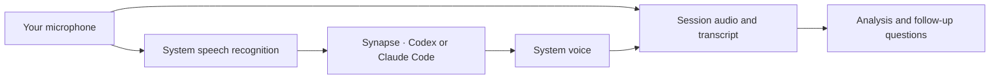

<p align="center">
  
</p>

# Resonanz

**Listen. Understand. Revisit.**

Record conversations, talk with AI and ask questions about previous sessions.
A desktop tray app with transcripts, session context and your locally installed
**Codex** and **Claude Code** assistants. No additional API keys. English and German interface, with English as the default.

[](https://github.com/pixel-brewery/resonanz/actions/workflows/ci.yml)


[](LICENSE)

[Get started](#run-locally) · [Features](#from-conversation-to-session) · [Voice](#talk-with-your-assistant) · [Setup](#connect-an-assistant) · [Documentation](docs/README.md) · [Contributing](CONTRIBUTING.md)

> **Public desktop prototype.** The source is available under MIT. The desktop
> checks build and exercise native packages on macOS and Windows. Earlier macOS
> integration checks also verified German microphone recognition, real Codex
> inference and spoken replies; Windows passed native en-US file recognition.
> The [verification record](docs/project/verification.md) distinguishes those
> results from the redesigned UI's controlled fixtures. Public installers and an
> automatic update feed remain separate distribution work.

## Why Resonanz

Conversations contain decisions, ideas, tasks and unanswered questions. Resonanz
keeps their audio and meaning together. Each recording becomes a session with a
transcript, analysis and question history, so you can return to the original
conversation rather than reconstructing it from memory.

The interface gives each session a visible shape: a linear audio fingerprint,
a circular chapter ring and a position in the weekly landscape. Typed markers
connect decisions, tasks and questions to their original moments.

## From conversation to session

| Workflow   | What it does                                                                                                     |
| ---------- | ---------------------------------------------------------------------------------------------------------------- |
| Record     | Choose a microphone, start explicitly, pause, resume and save ordered audio chunks.                              |
| Mark       | Flag a decision, task, question or personal moment during recording.                                             |
| Control    | Keep one recording running through the tray or the optional floating mini recorder, with marker undo.            |
| Transcribe | Use operating-system speech recognition, automatically after recording or on demand.                             |
| Explore    | Select chapters and markers in the resonance ring; play original excerpts or a short sequence of evidence clips. |
| Analyze    | Extract summaries, decisions, tasks and open questions through the selected local assistant.                     |
| Ask        | Ask follow-up questions with transcript references; select a time chip to inspect its original text and audio.   |
| Organize   | Search titles, tags and transcripts; use favorites, collections and the weekly landscape.                        |
| Connect    | Follow recurring analyzed topics across original passages and keep track of your completed tasks.                |
| Keep       | Import audio or session JSON; export audio, JSON or readable Markdown.                                           |

<p align="center">
  
</p>

The screenshot uses explicitly fictional design-handoff data in an isolated test
profile. It contains no personal recordings or account details. Waveform fixtures
illustrate layout; actual sessions use peaks measured from their local audio.

## Talk with your assistant

Live conversation combines native speech recognition, your authenticated local
assistant through **Synapse**, and system speech output. Microphone audio and
actually played assistant replies are archived on separate stereo channels.
You can interrupt, mute, pause and resume the conversation.



You can also speak a question about a saved session. That question uses a separate
native dictation operation and does not rewrite the recording's transcript.
The ring shows listening, lookup, response and original-audio states. Stored
summaries and answers can be read aloud with the unchanged upstream speech service.

See the [voice guide](docs/project/live-conversation.md) for lifecycle and archive details.

## Run locally

Requires **Node.js 24 LTS, at least 24.15.0 and below 25**, **Corepack** and
**Yarn 4.10.3**. `.nvmrc` and `package.json` pin the supported toolchain.

```sh
git clone https://github.com/pixel-brewery/resonanz.git
cd resonanz
corepack enable
yarn install --immutable
yarn start
```

`yarn start` builds the renderer and native processes before opening Electron.
`yarn start:built` opens an existing build. Pinned Mosaik and Synapse archives are
included in the checkout; no additional GitHub Packages credential or adjacent
source checkout is required.

Recording requires microphone permission and an audio output device. Native
transcription and voice conversation also require a recognition language and
system voice. Windows requires the relevant installed System.Speech/SAPI language
components. System-audio capture is still unavailable and is shown as such.

## Connect an assistant

1. Install Codex or Claude Code separately and select it in Settings.
2. Explicitly start an offered native browser or device-code account login.
3. Complete the native login and choose a model, language, voice and conversation instructions.
4. Analyze a session, ask a question or start a voice conversation.

Resonanz uses application-owned native profiles and does not silently import
credentials from a global CLI installation. The native account login is the AI
connection. A local CLI may use its provider's service for inference; local
execution does not imply fully offline inference.

Recordings and session files remain local. Requested transcript context and
markers are passed to the selected assistant. The [setup guide](docs/project/assistant-setup.md)
explains permissions, accounts and visible recovery states.

## Built on existing implementations

| Foundation                                            | Responsibility                                                                                               |
| ----------------------------------------------------- | ------------------------------------------------------------------------------------------------------------ |
| [Symphony](https://github.com/pixel-brewery/symphony) | Desktop process boundaries, native lifecycle, tray and packaging patterns.                                   |
| [Synapse](https://github.com/pixel-brewery/synapse)   | Public packages for native CLI authentication, isolated accounts, streaming, continuations and cancellation. |
| Mosaik                                                | Angular controls, Soho controls with the owner-approved warm palette, Georgia typography and icons.          |
| Upstream browser audio                                | 51 production files and twelve specifications with recorded provenance; one PCM identifier adaptation.       |

The runtime remains **Angular renderer → typed preload → Electron Main → supervised
Utility Process**. The renderer has no Node, filesystem, shell or credential-store
access. Original visualizations are standalone Angular components with typed
inputs and outputs; they do not own AI, storage or microphone operations.

Archive hashes and copied-source provenance are verified independently.
See the [architecture](docs/architecture/README.md) and
[component catalog](docs/architecture/frontend/components.md).

## Verify and package

Development verification also requires Python 3 for the offline
`yarn verify:skills` check of the pinned Architecture base and Resonanz skill.

```sh
yarn verify
yarn format:check
yarn test:e2e
```

```sh
yarn package
yarn verify:package
yarn test:e2e --packaged
yarn make
```

The [desktop CI](https://github.com/pixel-brewery/resonanz/actions/workflows/ci.yml)
checks macOS and Windows separately. Package verification compares actual bundles,
resources and license texts. The Windows speech checker uses native synthesis
and file recognition when a matching recognition package is installed. Ordinary
checks use synthetic data and isolated profiles, with no personal login or paid inference.

`RESONANZ_OUTPUT_DIR` selects a separate artifact directory. Host packaging does
not prove another operating system or release readiness.

Releases have no verified publisher signature. macOS uses certificate-free ad-hoc
sealing without notarization; Windows installers are unsigned. Certificate signing
and notarization are not planned. Download, open and use Resonanz at your own risk.
The source is public and the software is provided as is under the [MIT license](LICENSE).
See the [distribution guide](docs/project/distribution.md) for installer and update checks.

## Documentation and contribution

- [Product and workflows](docs/project/README.md)
- [Architecture and ownership](docs/architecture/README.md)
- [Project plan](docs/project-plan.md) and [decisions](docs/decisions.md)
- [Verification and remaining work](docs/project/verification.md)
- [Contributing](CONTRIBUTING.md), [code of conduct](CODE_OF_CONDUCT.md) and [security reports](SECURITY.md)

Use the [issue forms](https://github.com/pixel-brewery/resonanz/issues/new/choose)
with fictional examples. Resonanz belongs to the Pixel Brewery family alongside
[Archipel](https://github.com/pixel-brewery/archipel),
[Symphony](https://github.com/pixel-brewery/symphony) and
[Synapse](https://github.com/pixel-brewery/synapse).

## License

[MIT](LICENSE). Copied sources, archives and Inter fonts retain their additional
notices in [THIRD_PARTY_NOTICES.md](THIRD_PARTY_NOTICES.md).
