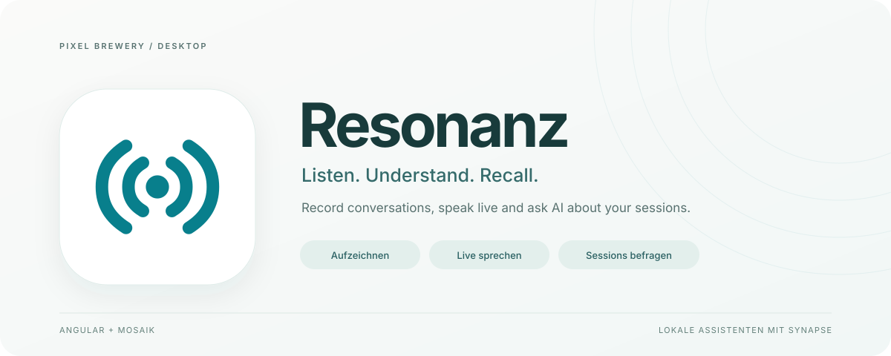

<p align="center">
  
</p>

# Resonanz

**Gespräche aufnehmen, live mit KI sprechen und Wissen aus Sessions wiederfinden.**

Eine Desktop-App im Tray. Aufnahme und Transkript zusammen. Sprachgespräche mit
den lokal installierten KI-Assistenten, Zusammenfassungen und spätere Fragen.
**Die Einrichtung erfolgt über die vorhandenen Assistentenkonten ohne API-Key.**


[Starten](#lokal-starten) · [Produktabläufe](#vom-gespräch-zur-nutzbaren-session) · [KI verbinden](#ki-und-audio-verbinden) · [Architektur](#auf-bestehenden-implementierungen-aufgebaut) · [Prüfungen](#prüfen-und-paketieren) · [Dokumentation](docs/README.md)

> **Lauffähiger Desktop-Prototyp.** Die Angular-/Mosaik-Oberfläche wurde mit dem
> nativen Host bedient: Aufnahme mit synthetischem Mikrofonsignal, Pause/Fortsetzen,
> tatsächliche Audiowiedergabe, Organisation, Import/Export und Persistenz nach
> Neustart sind geprüft. Codex-Anmeldung, echte Zusammenfassung und Folgefrage
> sowie das Vorlesen mit Systemstimme wurden ebenfalls ausgeführt. Unter macOS
> bestand auch ein tatsächliches keyloses Sprachgespräch einschließlich
> Unterbrechen, Mute, Pause/Fortsetzen und beider Audiokanäle. Windows wird separat geprüft.
> Der konkrete Stand steht in der [Abnahme](docs/project/abnahme.md).

## Vom Gespräch zur nutzbaren Session

Resonanz bündelt Aufzeichnung, Live-Unterhaltung und spätere Auswertung in einer
Bibliothek. Jede Session erhält ihren eigenen Gesprächskontext.

| Schritt                  | Produktablauf                                                                                                                                                   |
| ------------------------ | --------------------------------------------------------------------------------------------------------------------------------------------------------------- |
| **Aufzeichnen**          | Mikrofon auswählen, Aufnahme starten, pausieren und beenden; bereits bestätigte Audioblöcke fortlaufend erhalten.                                               |
| **Live sprechen**        | Systemeigene Spracherkennung mit dem über Synapse angemeldeten Codex-/Claude-Assistenten und nativer Sprachausgabe verbinden; sprechen, hören und unterbrechen. |
| **Transkribieren**       | Audio mit der verfügbaren systemeigenen Spracherkennung in zeitmarkierten Text umwandeln.                                                                       |
| **Auswerten**            | Über Synapse Kernaussagen, Entscheidungen, Aufgaben und offene Fragen aus dem Transkript erarbeiten.                                                            |
| **Weiterfragen**         | Die konkrete Session befragen, Antworten fortlaufend lesen und Aussagen anhand ihrer Zeitmarken wiederfinden.                                                   |
| **Ordnen und mitnehmen** | Titel, Sammlungen, Tags und Favoriten nutzen; Audio oder Resonanz-JSON importieren sowie Audio, JSON und Markdown exportieren.                                  |

Die Oberfläche wird mit **Angular und Mosaik** umgesetzt. **Synapse** bindet
Codex und Claude Code über ihre installierten nativen CLIs an. Derselbe
Assistent beantwortet gesprochene Beiträge, wertet Transkripte aus und beantwortet
spätere Fragen. Die Sprachfunktionen verwenden das Betriebssystem; Vorlesen nutzt
den unveränderten Flamox-Text-to-Speech-Service.

<p align="center">
  
</p>

Die Abbildung stammt aus dem Bedienlauf der tatsächlichen App. Der Prüftext wurde
manuell eingegeben; die Aufnahme verwendet ein synthetisches Mikrofonsignal.

Der vollständige Prototypumfang und seine offenen Laufzeitprüfungen bleiben im
[Projektplan](docs/projektplan.md) und in der [Produktdokumentation](docs/project/README.md)
festgehalten.

## Lokal starten

Benötigt werden **Node.js 24 LTS ab 24.15.0** und **Yarn 4.10.3**. `.nvmrc` hält
den gemeinsamen Basisstand fest. Das Repository enthält
die gepinnten Mosaik-/Synapse-Paketarchive; benachbarte Quellcheckouts und ein
zusätzlicher GitHub-Packages-Token sind für diese Pakete nicht erforderlich.

```sh
git clone https://github.com/pixel-brewery/resonanz.git
cd resonanz
yarn install --immutable
yarn start
```

Das derzeit private Repository erfordert den passenden GitHub-Zugriff.
`yarn start` baut Renderer und native Prozesse und öffnet anschließend Electron.
Ein vorhandener Build lässt sich mit `yarn start:built` öffnen.

Das Schließen des Fensters blendet die App aus; der Tray beziehungsweise die
macOS-Menüleiste bleibt der Einstieg. Aufnahmen werden durch eine bewusste
Startaktion begonnen.

## KI und Audio verbinden

| Funktion                               | Voraussetzung                                                                               |
| -------------------------------------- | ------------------------------------------------------------------------------------------- |
| Aufnahme und Wiedergabe                | Freigegebenes Mikrofon, verfügbare Audioausgabe und funktionierender nativer Medienpfad     |
| Lokale KI-Auswertung und Sessionfragen | Installierte Codex-/Claude-CLI und eine explizite Kontoanmeldung im Resonanz-eigenen Profil |
| Live-Unterhaltung                      | Derselbe angemeldete Assistent sowie verfügbare systemeigene Spracherkennung und Stimme     |
| Dateitranskription                     | Verfügbare native Spracherkennung für die ausgewählte Sprache                               |
| Vorlesen                               | Tatsächlich verfügbare Browser-/Betriebssystemstimme                                        |

Die Kontoanmeldung der installierten CLI genügt für die KI-Anbindung. Resonanz
verlangt keinen zusätzlichen Sprachdienst, API-Key oder Audiomodellzugang.
Die Modellinferenz folgt dem angemeldeten Assistenten; ein lokal gestarteter
Codex-/Claude-Prozess bedeutet nicht automatisch Offline-Inferenz.

Die Einstellungen enthalten Assistent, natives Modell, Sprache, vorhandene Stimme
und Gesprächsanweisung. Fehlende Sprachpakete oder Systemfreigaben werden als
solche angezeigt. Globale CLI-Zugangsdaten werden nicht stillschweigend kopiert,
und fehlgeschlagene Inferenz wird nicht durch eine Demoantwort ersetzt.

Die [Einrichtungsanleitung](docs/project/ki-und-einrichtung.md) beschreibt den
Kontoweg und die jeweiligen Voraussetzungen.

## Auf bestehenden Implementierungen aufgebaut

| Grundlage           | Verwendung in Resonanz                                                                                                                                                             |
| ------------------- | ---------------------------------------------------------------------------------------------------------------------------------------------------------------------------------- |
| **Symphony**        | Sandboxed Angular Renderer → typisierte Preload-API → Electron Main → beaufsichtigter Utility Process; native Lebenszyklen und Paket-/Icon-Muster.                                 |
| **Synapse 0.0.3**   | Öffentliche Pakete für isolierte Konten, native Anmeldung, Streaming, gebundene Fortsetzungen und abgewarteten Abbruch.                                                            |
| **Mosaik 0.1.183**  | Öffentliche Angular-/Webcomponent-Steuerelemente, Theme und Icon-Vokabular.                                                                                                        |
| **FLAMOX365-Audio** | 51 Produktionsdateien und 12 Verhaltensspezifikationen unverändert übernommen; Recorder, PCM, Wiedergabe und Text-to-Speech bleiben bytegleich zu ihrem dokumentierten Quellstand. |

Audioherkunft und Paketarchive besitzen eigene SHA-256-Manifeste und Prüfungen.
Desktop-/Sessionanpassungen liegen außerhalb der unveränderten Audioquellen.
Die Live-Strecke verbindet echte System-Spracherkennung, Synapse-Textstreams und
hörbare native Sprachclips. Es gibt keinen separaten Cloud-Audiopfad.

Die [Architekturübersicht](docs/architecture/README.md) erklärt Zuständigkeiten,
Referenzrevisionen und bewusste Prototypanpassungen. Die eigene Resonanz-Bildmarke
wird für Fenster, Dock, Tray und native Icon-Container erzeugt; ihre Quelle liegt
unter [resources/icons](resources/icons/README.md).

## Prüfen und paketieren

```sh
yarn verify:vendor
yarn verify:audio
yarn typecheck
yarn test
yarn build
yarn test:e2e
```

`yarn verify` führt die konfigurierten Herkunfts-, Typ-, Test- und Buildprüfungen
zusammen aus. `yarn test:e2e` bedient den gebauten Electron-Prototyp mit einem
synthetischen Mikrofon, eigenem Datenprofil und kontrollierter Dateiauswahl.
Es meldet keine Anmeldung an und ruft keine kostenpflichtige KI auf.

```sh
yarn package
yarn verify:package
yarn test:e2e --packaged
yarn make
```

Diese Befehle bauen ein natives Programmpaket beziehungsweise die für das
Hostsystem vorgesehenen Installer/Archive. Öffentliche, vertrauenswürdig
signierte/notarisierte Releases und automatische Updates sind separate
Auslieferungsschritte. Eine fertige Windows-Installation wird aus einer
macOS-Konfiguration nicht abgeleitet.

## Dokumentation und Mitarbeit

- [Dokumentationsindex](docs/README.md)
- [Produkt und Bedienung](docs/project/README.md)
- [Architektur und Quellen](docs/architecture/README.md)
- [Projektplan](docs/projektplan.md) und [Entscheidungen](docs/entscheidungen.md)
- [Abnahme und tatsächliche Nachweise](docs/project/abnahme.md)
- [Mitarbeit und lokale Prüfungen](CONTRIBUTING.md)
- [Vollständige Drittanbieterhinweise und Schriftlizenzen](THIRD_PARTY_NOTICES.md)

Die Lizenzhinweise des übernommenen Materials bleiben erhalten. Sichtbarkeit,
Lizenz der Resonanz-eigenen Quellen und öffentliches Veröffentlichungsmodell sind
noch nicht abschließend festgelegt.
