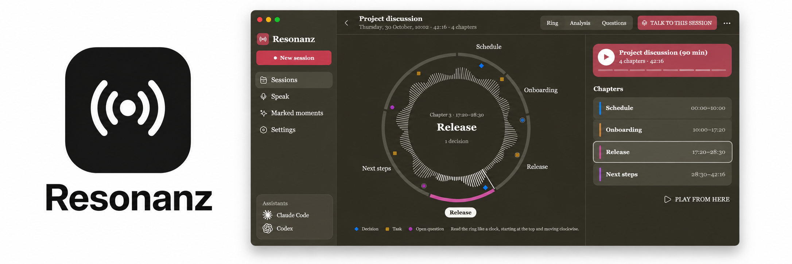
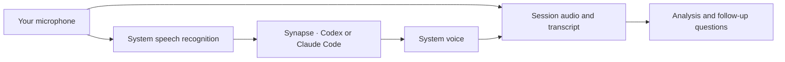

<p align="center">
  
</p>

# Resonanz

**Record conversations, talk with AI, and revisit every decision.**

Native speech. Local assistant accounts. Session timelines. No additional API keys.

[](https://github.com/pixel-brewery/resonanz/actions/workflows/ci.yml)
[](https://github.com/pixel-brewery/resonanz/actions/workflows/release.yml)
[](LICENSE)

[Install](#install) · [Workflow](#from-conversation-to-session) · [Capabilities](#what-it-does) · [Voice](#talk-with-your-assistant) · [Build from source](#build-from-source) · [Documentation](docs/README.md) · [Contributing](CONTRIBUTING.md)

> **Desktop prototype.** The [verification record](docs/project/verification.md)
> distinguishes controlled desktop checks, earlier real speech and assistant-account
> checks, and native installation evidence. A passing fixture is evidence for its own scope.

## From conversation to session

Resonanz is a desktop tray application for recording, spoken conversation and
session-based analysis. Each recording keeps its audio, transcript, markers and
question history together, so you can return to the original conversation.

| Step                            | Work in Resonanz                                                                                                                     |
| ------------------------------- | ------------------------------------------------------------------------------------------------------------------------------------ |
| **Start a session**             | Choose a microphone and explicitly start recording, or import existing audio or a session.                                           |
| **Capture what matters**        | Pause and resume, mark a decision, task, question or personal moment, and keep control through the tray or floating mini recorder.   |
| **Understand the conversation** | Transcribe with system speech recognition, then ask the selected local assistant for summaries, decisions, tasks and open questions. |
| **Revisit the evidence**        | Explore chapters and markers in the session ring, play original excerpts and ask follow-up questions with transcript references.     |

Recordings and session files stay local. When you request analysis or an answer,
Resonanz passes the selected transcript context and markers to Codex or Claude Code
through Synapse. These CLIs may use their provider's service for inference; local
execution does not promise fully offline inference.

The hero is an illustrated composition based on the existing
[interface preview](.github/assets/resonanz-app.png). Both use fictional example
sessions, with no personal recordings or account details. Actual session waveforms
use peaks measured from their local audio.

## Install

Download the latest installer for your platform from
[Releases](https://github.com/pixel-brewery/resonanz/releases/latest):

| Platform              | Release asset                         |
| --------------------- | ------------------------------------- |
| macOS (Apple Silicon) | `Resonanz-darwin-arm64-<version>.dmg` |
| Windows (x64)         | `Resonanz-win32-x64-<version>.exe`    |

Each release includes the matching `update-darwin-arm64.json` and
`update-win32-x64.json` manifests with installer size, SHA-256 and download URL.
The app can check for an update, download the matching installer on request,
verify it and open it for installation.

macOS uses certificate-free ad-hoc sealing without notarization; Windows installers
are unsigned. Certificate signing and notarization are not planned. Operating
systems may warn about or block these downloads. Review the
[public source](https://github.com/pixel-brewery/resonanz), download and run at your
own discretion, under the [MIT license](LICENSE). See the
[distribution guide](docs/project/distribution.md) for installer and update checks.

### What you need alongside it

- A microphone, microphone permission and an audio output device for recording
- An installed recognition language and system voice for transcription and spoken conversation;
  Windows uses the corresponding System.Speech/SAPI language components
- An installed Codex or Claude Code CLI and an authenticated account for AI features

System-audio capture is unavailable and shown as such. The interface supports
English and German, with English as the default.

## What it does

- **Record and mark.** Save ordered audio chunks, pause and resume, and mark
  decisions, tasks, questions and personal moments while recording.
- **Stay in control.** Use the tray or optional floating mini recorder to control
  the current recording and undo a marker.
- **Transcribe natively.** Use operating-system speech recognition automatically
  after recording or on demand, without an additional audio API key.
- **Explore sessions.** Follow a circular chapter ring, a linear audio fingerprint
  and the weekly landscape. Jump to a marker or play a sequence of original evidence clips.
- **Analyze and ask.** Request summaries and follow-up answers through the selected
  assistant. Time chips lead back to the referenced transcript and audio.
- **Organize your library.** Search titles, tags and transcripts; use favorites and
  collections, follow recurring analyzed topics and track completed tasks.
- **Talk and listen.** Hold a live conversation, dictate a question about a saved
  session, or read a stored summary or answer aloud.
- **Keep your work portable.** Import audio or session JSON and export audio,
  JSON or readable Markdown.

## Talk with your assistant

Live conversation combines native speech recognition, your authenticated local
assistant through Synapse, and system speech output. Microphone audio and actually
played assistant replies are archived on separate stereo channels. You can
interrupt, mute, pause and resume the conversation.



Speaking a question about a saved session uses a separate native dictation operation
and does not rewrite the recording's transcript. The ring shows listening, lookup,
response and original-audio states. See the
[voice guide](docs/project/live-conversation.md) for lifecycle and archive details.

### Connect an assistant

1. Install Codex or Claude Code separately and select it in Settings.
2. Explicitly start the offered native browser or device-code login and complete it.
3. Choose a model, language, voice and conversation instructions.
4. Analyze a session, ask a question or start a voice conversation.

Resonanz uses application-owned native profiles. It does not silently import
credentials from a global CLI installation. The native account login is the AI
connection; no separate API-key setup is required. The
[setup guide](docs/project/assistant-setup.md) explains permissions, accounts and recovery states.

## Architecture

The runtime path is Angular Renderer → typed Preload → Electron Main → supervised
Utility Process. The renderer has no Node, filesystem, shell or credential-store
access. Shared DTOs and Zod validation live in `libs/contracts`; native execution,
session persistence and assistant accounts stay outside the renderer.

| Owner               | Responsibility                                                   |
| ------------------- | ---------------------------------------------------------------- |
| `apps/renderer`     | Angular views, presenters and browser media                      |
| `apps/desktop`      | Electron lifecycle, tray, preload, native permissions and speech |
| `apps/orchestrator` | Application use cases and supervised utility process             |
| `libs/sessions`     | Versioned sessions, catalog and ordered audio journal            |
| `libs/assistant`    | Synapse integration and normalized assistant lifecycle           |
| `libs/audio`        | Provenance-verified upstream audio and explicit host composition |
| `libs/intl`         | English/German tables and message formatting                     |

Mosaik supplies the controls and theme APIs. Synapse owns native CLI authentication,
isolated accounts, streaming, continuations and cancellation. Symphony supplies
established desktop lifecycle and packaging patterns. Copied audio sources retain
their provenance and complete notices.

Start with the [architecture index](docs/architecture/README.md),
[desktop lifecycle](docs/architecture/desktop/README.md),
[component catalog](docs/architecture/frontend/components.md) and
[Resonanz Architect](.agents/skills/resonanz-architect/SKILL.md).

## Build from source

Requires Node.js **24 LTS, at least 24.15.0 and below 25**, Corepack and
Yarn **4.10.3**, as pinned by `.nvmrc` and `package.json`.
Development verification also requires Python 3 for the offline skill check.

```sh
git clone https://github.com/pixel-brewery/resonanz.git
cd resonanz
corepack enable
yarn install --immutable
yarn start
```

`yarn start` builds the renderer and native processes, then launches Electron.
`yarn start:built` reuses an existing build. Pinned Mosaik and Synapse archives
are included; no additional GitHub Packages credential or adjacent checkout is required.

Quality and packaging commands:

```sh
yarn verify          # provenance, public content, types, tests and builds
yarn format:check    # repository formatting
yarn test:e2e        # built desktop app with isolated synthetic media
yarn package         # native application bundle for this machine
yarn verify:package  # compare the artifact with the current build
yarn test:e2e --packaged
yarn make            # native installer/archive makers supported by the host
```

`RESONANZ_OUTPUT_DIR` selects a separate artifact directory. Controlled checks use
synthetic data and isolated profiles. Real microphone capture, native speech,
assistant-account inference, each operating system and native installation have
separate evidence in the [verification record](docs/project/verification.md).

Full contributor guidance is in [CONTRIBUTING.md](CONTRIBUTING.md), and
[AGENTS.md](AGENTS.md) holds the repository rules.

## Releases and updates

Changes beyond documentation on `main` request a release. Nx prepares one version,
changelog, commit and `v<version>` tag; macOS and Windows builds verify the same
candidate before the pipeline publishes installers and update manifests.
Documentation-only changes skip tests, builds, packaging and automatic release.
Explicit manual releases still run the complete pipeline.

Releases belong to the owner. The
[technical distribution guide](docs/architecture/distribution/README.md) describes
publication prerequisites, source identity, retries and the permanent unsigned policy.
[Repository quality](docs/architecture/repository-quality/README.md) records the
CI documentation filter and required check names.

## Contributing and security

Use the [issue forms](https://github.com/pixel-brewery/resonanz/issues/new/choose)
with fictional examples. Start with [CONTRIBUTING.md](CONTRIBUTING.md) and the
[Code of Conduct](CODE_OF_CONDUCT.md). Report vulnerabilities privately through
[GitHub Security Advisories](https://github.com/pixel-brewery/resonanz/security/advisories/new);
[SECURITY.md](SECURITY.md) explains the reporting scope.

The [documentation index](docs/README.md) links product workflows and technical
contracts. The [project plan](docs/project-plan.md) and
[decisions](docs/decisions.md) record the binding scope and implemented choices.

## License

[MIT](LICENSE). Copied sources, archives and Inter fonts retain their additional
notices in [THIRD_PARTY_NOTICES.md](THIRD_PARTY_NOTICES.md).
