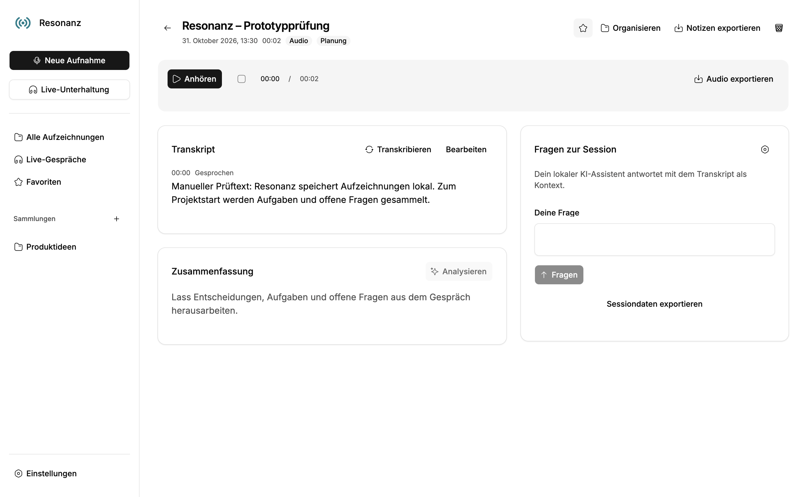
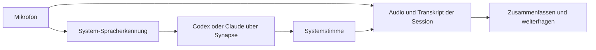

<p align="center">
  
</p>

# Resonanz

**Zuhören. Verstehen. Wiederfinden.**

Gespräche aufnehmen, live mit KI sprechen und gespeicherte Sessions später befragen.
Eine Desktop-App im Tray — mit Transkripten, Gesprächskontext und den lokal
installierten Assistenten **Codex** und **Claude Code**. Ohne zusätzliche API-Keys.

[](https://github.com/pixel-brewery/resonanz/actions/workflows/ci.yml)


[](LICENSE)

[Starten](#lokal-starten) · [Funktionen](#vom-gespräch-zur-nutzbaren-session) · [Live sprechen](#mit-deinem-assistenten-sprechen) · [KI einrichten](#ki-verbinden) · [Dokumentation](docs/README.md) · [Mitmachen](CONTRIBUTING.md)

> **Öffentlicher Desktop-Prototyp.** Der Quellcode ist unter MIT verfügbar.
> macOS und Windows werden mit tatsächlichen Builds, nativen Paketen und
> kontrollierten Bedienläufen geprüft. Deutsche Mikrofonerkennung, Codex-Inferenz
> und gesprochene Antworten wurden unter macOS praktisch getestet; Windows hat
> zusätzlich einen nativen Sprachdateitest mit en-US. Die
> [Abnahme](docs/project/abnahme.md) beschreibt die genauen Nachweise und Grenzen.
> Der Einstieg erfolgt derzeit über den Quellcode; öffentliche Installer und
> automatische Updates sind noch kein Bestandteil dieser Auslieferung.

## Warum Resonanz

Gespräche enthalten Entscheidungen, Ideen, Aufgaben und Fragen. Resonanz hält
Audio und Inhalt zusammen: Jede Aufzeichnung wird zu einer Session mit
Transkript, Auswertung und eigenem Fragenverlauf. So kannst du den Gesprächsstand
auch später nachvollziehen und weiterbearbeiten.

Du entscheidest, ob Resonanz zuhört und aufzeichnet oder ob du direkt mit deinem
Assistenten sprechen möchtest. Die App bleibt über die Menüleiste beziehungsweise
den Tray erreichbar, wenn du das Hauptfenster schließt.

## Vom Gespräch zur nutzbaren Session

| Schritt            | Was du in Resonanz machst                                                                                                                                                    |
| ------------------ | ---------------------------------------------------------------------------------------------------------------------------------------------------------------------------- |
| **Aufzeichnen**    | Mikrofon auswählen, aufnehmen, pausieren, fortsetzen und beenden. Bestätigte Audioblöcke werden fortlaufend gespeichert.                                                     |
| **Transkribieren** | Aufnahmen mit der systemeigenen Erkennung in zeitmarkierten Text umwandeln. Die automatische Transkription nach Aufnahmeende ist abschaltbar; Texte lassen sich korrigieren. |
| **Verstehen**      | Den angebundenen Assistenten um Kernaussagen, Entscheidungen, Aufgaben und offene Fragen bitten.                                                                             |
| **Weiterfragen**   | Eine Session befragen und Folgefragen im selben Kontext stellen. Antworten können auf Zeitmarken aus dem Transkript verweisen.                                               |
| **Wiederfinden**   | Titel, Sammlungen, Tags und Favoriten verwenden; Aufzeichnungen nach Titel und Tags durchsuchen.                                                                             |
| **Mitnehmen**      | Audio und Resonanz-JSON importieren sowie Audio, Sessiondaten als JSON und Notizen als Markdown exportieren.                                                                 |

<p align="center">
  
</p>

Die Bildschirmaufnahme zeigt die tatsächliche Angular-/Mosaik-App aus einem
kontrollierten Bedienlauf. Der sichtbare Text wurde manuell vorgegeben; die
Aufnahme verwendet ein synthetisches Mikrofonsignal. Der Bildheader ist eine
[eigene Produktillustration](.github/assets/README.md).

## Mit deinem Assistenten sprechen

Eine Live-Unterhaltung verbindet das Standardmikrofon mit der verfügbaren
Systemerkennung. Erkannte Beiträge gehen als Text an den angemeldeten Assistenten.
Seine Antwort wird in sprechbare Abschnitte überführt und mit einer Systemstimme
wiedergegeben.



Du kannst Antworten unterbrechen, das Mikrofon stummschalten und das Gespräch
pausieren oder fortsetzen. Deine Beiträge und tatsächlich abgespielte Antworten
werden auf getrennten Audiokanälen archiviert. Vollständig abgespielte
Antwortabschnitte erhalten einen Transkripteintrag. Gespeicherte Zusammenfassungen
und Antworten lassen sich ebenfalls vorlesen.

Der [Gesprächsleitfaden](docs/project/live-unterhaltung.md) erklärt den Ablauf,
Unterbrechungen und die verfügbaren Sprachfunktionen.

## Lokal starten

Benötigt werden **Node.js 24 LTS ab 24.15.0, kleiner als 25**, **Corepack** und
**Yarn 4.10.3**. `.nvmrc` und `package.json` halten den gemeinsamen Stand fest.

```sh
git clone https://github.com/pixel-brewery/resonanz.git
cd resonanz
corepack enable
yarn install --immutable
yarn start
```

`yarn start` baut Renderer und native Prozesse und öffnet Electron.
`yarn start:built` öffnet einen vorhandenen Build. Die gepinnten Mosaik- und
Synapse-Paketarchive gehören zum Checkout; für diese Abhängigkeiten brauchst du
keinen zusätzlichen GitHub-Packages-Token und keine benachbarten Quellcheckouts.

Für Aufnahme und Wiedergabe brauchst du ein freigegebenes Mikrofon und eine
Audioausgabe. Native Transkription und Sprachgespräche benötigen eine installierte
Erkennungssprache und passende Systemstimme. Unter Windows ist das für die
gewünschte Sprache verfügbare System.Speech-/SAPI-Paket erforderlich.

## KI verbinden

1. Codex oder Claude Code auf dem Rechner installieren und in Resonanz unter
   **Einstellungen** auswählen.
2. Die angebotene native Kontoanmeldung ausdrücklich starten und im Browser
   beziehungsweise mit dem Gerätecode abschließen.
3. Modell, Sprache, verfügbare Stimme und Gesprächsanweisung festlegen.
4. Eine Session auswerten, eine Frage stellen oder eine Live-Unterhaltung starten.

Resonanz verwendet ein eigenes Anwendungsprofil und übernimmt globale
CLI-Zugangsdaten nicht stillschweigend. Die native Kontoanmeldung genügt für die
KI-Anbindung. Modellinferenz folgt dem ausgewählten Assistenten und dessen Dienst;
ein lokal gestarteter CLI-Prozess bedeutet keinen zugesicherten Offlinebetrieb.

Audio und Sessiondaten werden lokal gespeichert. Für KI-Anfragen wird der
relevante Gesprächskontext an den gewählten Assistenten übergeben. Die
[Einrichtungsanleitung](docs/project/ki-und-einrichtung.md) beschreibt die Konten,
Sprachvoraussetzungen und sichtbaren Fehlerzustände.

## Auf bestehenden Implementierungen aufgebaut

| Grundlage                                             | Verantwortung in Resonanz                                                                                       |
| ----------------------------------------------------- | --------------------------------------------------------------------------------------------------------------- |
| [Symphony](https://github.com/pixel-brewery/symphony) | Desktop-Prozessgrenzen, native Lebenszyklen und Muster für Fenster, Tray und Paketierung.                       |
| [Synapse](https://github.com/pixel-brewery/synapse)   | Öffentliche TypeScript-Pakete für native CLI-Anmeldung, isolierte Konten, Streaming, Fortsetzungen und Abbruch. |
| **Mosaik**                                            | Angular-/Webcomponent-Steuerelemente, Theme und Icons.                                                          |
| **FLAMOX365-Audio**                                   | 51 Produktionsdateien und zwölf Specs für Recorder, PCM, Wiedergabe und Text-to-Speech unverändert übernommen.  |

Die Laufzeit folgt **Angular Renderer → typisierte Preload-API → Electron Main →
beaufsichtigter Utility Process**. Der Renderer hat keine Node- oder
Dateisystemrechte. Aufnahme und Wiedergabe liegen im Browser-Medienpfad, native
Sprache im Desktop-Host und Sessionablage sowie Synapse-Ausführung im Utility.

Kopierte Audioquellen und Paketarchive besitzen prüfbare SHA-256-Manifeste.
Resonanz-Komposition bleibt außerhalb des unveränderten Dateisatzes. Die
[Architekturübersicht](docs/architecture/README.md) beschreibt die Besitzer,
Referenzstände und bewussten Anpassungen.

## Prüfen und paketieren

```sh
yarn verify          # Herkunft, Typen, Verhalten und Builds
yarn format:check    # Formatierung
yarn test:e2e        # Native App mit kontrolliertem Mikrofon und eigenem Profil
```

```sh
yarn package
yarn verify:package
yarn test:e2e --packaged
yarn make
```

Die [Desktop-CI](https://github.com/pixel-brewery/resonanz/actions/workflows/ci.yml)
führt die Prüfungen getrennt unter macOS und Windows aus. Paketprüfungen vergleichen
Builds, Ressourcen und Lizenztexte. Der Windows-Sprachprüfer verwendet die echte
Systemstimme und — mit installiertem passendem Sprachpaket — native
Dateierkennung. Normale Tests verwenden künstliche Daten und keine persönlichen
Assistentenkonten.

`yarn package` und `yarn make` erzeugen native Pakete für das Hostsystem.
`RESONANZ_OUTPUT_DIR` erlaubt einen eigenen Ausgabeordner für die Prüfung.
Signierung, Notarisierung und veröffentlichte Installer sind eigene Schritte;
der [Auslieferungsleitfaden](docs/project/veroeffentlichung.md) trennt sie von
der öffentlichen Quellcodefreigabe.

## Dokumentation und Mitarbeit

- [Produkt und Bedienung](docs/project/README.md) — Aufnahme, Gespräch, Organisation und Einrichtung
- [Architektur](docs/architecture/README.md) — Prozessmodell, Audio und native Assistenten
- [Plan und Entscheidungen](docs/projektplan.md) — Umfang und nächste Produktentscheidungen
- [Abnahme](docs/project/abnahme.md) — tatsächliche Prüfungen und verbleibende Grenzen
- [Mitarbeiten](CONTRIBUTING.md) — Setup, Quellenregeln und sinnvolle Prüfungen
- [Verhaltenskodex](CODE_OF_CONDUCT.md) und [Sicherheitsmeldungen](SECURITY.md)

Fehler, Ideen und Fragen sind in den [Issues](https://github.com/pixel-brewery/resonanz/issues)
willkommen. Bitte verwende für Beispiele künstliche Gesprächsinhalte.

Resonanz gehört zur Pixel-Brewery-Projektfamilie neben
[Archipel](https://github.com/pixel-brewery/archipel),
[Symphony](https://github.com/pixel-brewery/symphony) und
[Synapse](https://github.com/pixel-brewery/synapse).

## Lizenz

[MIT](LICENSE). Übernommene Quellen, Paketarchive und Inter-Schriften behalten
zusätzlich ihre jeweiligen Hinweise und Bedingungen; siehe
[THIRD_PARTY_NOTICES.md](THIRD_PARTY_NOTICES.md).
