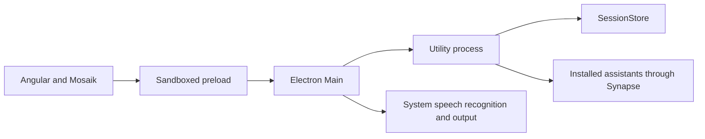

# Architecture

Resonanz follows Renderer → typed preload → Electron Main → supervised Utility.
It has no internal product HTTP server and no additional database service.

| Owner               | Responsibility                                                                             |
| ------------------- | ------------------------------------------------------------------------------------------ |
| `apps/renderer`     | Standalone OnPush views, Signals, presenters, browser media and reusable visualizations    |
| `libs/contracts`    | Shared DTOs, method/event catalog and consistent Zod validation                            |
| `libs/intl`         | English/German translation tables and runtime-independent message formatting               |
| `apps/desktop`      | Electron lifecycle, tray, permission mediation, dialogs, protected media and native speech |
| `apps/orchestrator` | Session use cases, context selection and supervised assistant work                         |
| `libs/sessions`     | Versioned local catalog/session documents and ordered audio journal                        |
| `libs/assistant`    | Long-lived Synapse host adapter with normalized account/run lifecycles                     |
| `libs/audio`        | Provenance-verified upstream audio primitives plus identified host composition             |

The renderer has no Node, shell, general filesystem or credential-store access.
Session persistence and native AI execution stay outside it. Synapse owns native
CLI drivers, accounts, authentication, inference, streaming and cancellation.
System recognition/output supplies the speech path without another API key.

## Reference choices

| Reference                     | Adopted or adapted behavior                                                                |
| ----------------------------- | ------------------------------------------------------------------------------------------ |
| Symphony                      | Process boundaries, validated transport, native lifecycle and coordinated Synapse profiles |
| Symphony persistence          | Adapted to versioned JSON and audio journals; no Git/delivery product domain               |
| Upstream audio                | Original hashes, one explicit PCM identifier adaptation and host-owned composition         |
| Upstream internationalization | Mosaik translation registry, flat language tables and a signal facade; English default     |
| Mosaik                        | Public Angular/web-component packages, customized Soho modes, Georgia and Reicon           |
| Resonanz handoff              | Independent visual components supplied with real session data                              |

## Reproducible provenance

| Material                             | Reference                                                                                                                         |
| ------------------------------------ | --------------------------------------------------------------------------------------------------------------------------------- |
| Copied upstream audio                | `b4a9eb8099d968c87c0d6aa20f3dfc037ee86127`; original paths and all hashes in [audio provenance](../../libs/audio/provenance.json) |
| Symphony desktop/Synapse inspection  | `e954c44da6e20ee0a60675c33b704b155a3a8750`; further desktop inspection at `4eac851f2dc465c4ed1ae7a09c245d6bce5de4ee`              |
| Synapse distributions                | `0.0.3`, revision `050ec502133aa0e0311dec8bc96023457d3f52aa`; [manifest](../../vendor/synapse/provenance.json)                    |
| Additional Synapse inspection        | `24b4bda76edc175ba69068fa36c556a2ec50ca35` (`0.0.4`); no library implementation changes relative to `v0.0.3`                      |
| Mosaik distributions                 | `0.1.183`; original digests and one documented themes-comment adaptation in [provenance](../../vendor/mosaik/provenance.json)     |
| Mosaik source inspection             | `804f83fb134024b36e7ecced8d5ee00a8634f9a7`; installed distribution APIs remain authoritative                                      |
| upstream language pattern inspection | `a9d5dd25487b9f040cd8107c9968294112e8e972`; TranslateFacade, language registries and presentation provider                        |

Reference checkouts are read-only and are not runtime dependencies. A fresh checkout
uses pinned vendor archives and normal public dependencies without personal source
aliases. Complete upstream license text is retained in
[THIRD_PARTY_NOTICES](../../THIRD_PARTY_NOTICES.md).

## Persistence and recovery

The Utility serializes writes, atomically replaces metadata and acknowledges audio
blocks in sequence. Previously active sessions become interrupted on recovery.
Only acknowledged host writes are durable; a pending renderer queue is not an
acknowledged audio journal. Protected audio URLs resolve validated session IDs,
not arbitrary paths. Native continuation/account references remain private.

See [desktop](desktop/README.md), [audio](audio/README.md),
[frontend](frontend/README.md), [local assistants](local-assistants/README.md) and
[verification](../project/verification.md).
