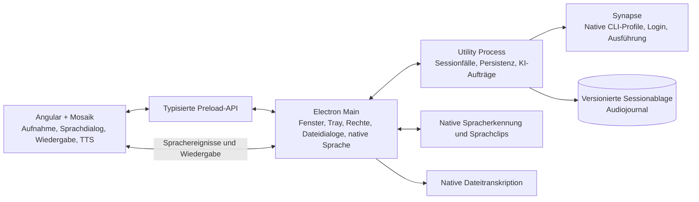

# Architektur

## Ziel und implementierte Besitzer

Resonanz übernimmt Symphonys Trennung zwischen sandboxiertem Renderer, typisierter
Preload-API, Electron Main und beaufsichtigtem Utility Process. Das vollständige
Produktziel umfasst zugleich echte Live-Audioverbindung, Aufnahmeverwaltung und
lokale KI-Auswertung. Der Implementierungsstand ist in Quellbesitzer gegliedert;
der Nutzerweg wird getrennt in der [Abnahme](../project/abnahme.md) nachgewiesen.

Der Renderer erhält keine allgemeinen Node-/Dateisystem-/Prozessschnittstellen.
Anfragen, Antworten und Ereignisse passieren die gemeinsamen Verträge. Electron
Main prüft zusätzlich Absender und Hauptframe. Der Sprachdialog verwendet systemeigene Erkennung und Ausgabe.
Gesprochene Beiträge werden direkt an den angemeldeten Assistenten über Synapse
übergeben; derselbe Kontext trägt spätere Fragen und Analysen.

## Fachbezogene technische Einstiege

- [Audio, Aufnahme und Live-Verbindung](audio/README.md)
- [Lokale Assistenten und Synapse](local-assistants/README.md)
- [Desktop, Verträge und Persistenz](desktop/README.md)
- [Angular-/Mosaik-Oberfläche](frontend/README.md)

| Besitzer            | Verantwortlichkeit                                                                                            |
| ------------------- | ------------------------------------------------------------------------------------------------------------- |
| `apps/renderer`     | Angular-/Mosaik-Oberfläche und Browsermedien; keine native Prozessausführung                                  |
| `libs/audio`        | Nachweislich unveränderte Flamox-Audioprimitive einschließlich TTS                                            |
| `libs/contracts`    | Öffentliche DTOs, Methoden-/Ereigniskatalog und Laufzeitvalidierung                                           |
| `apps/desktop`      | Electron-Lebenszyklus, Tray, Preload, sichere Mediendatei-URLs, native Dialoge, systemeigene Sprachfunktionen |
| `apps/orchestrator` | Sessionanwendungsfälle und koordinierte Auswertung/Fragen/Delegation                                          |
| `libs/sessions`     | Katalog, Metadaten, Audiojournal und private Fortsetzungen                                                    |
| `libs/assistant`    | Produktneutraler Synapse-Hostadapter mit expliziten Accounts und Lebenszyklen                                 |

## Übernommene Muster und begründete Anpassungen

| Referenz                                          | Entscheidung                                                                                                                                        |
| ------------------------------------------------- | --------------------------------------------------------------------------------------------------------------------------------------------------- |
| Symphony: Renderer → Preload → Main → Utility     | Übernommen; keine allgemeine lokale HTTP-API und keine native KI im Angular-Renderer                                                                |
| Symphony: gemeinsame validierte Transportverträge | Übernommen und auf Sessions, Audio und Assistentenaufrufe zugeschnitten                                                                             |
| Symphony: Synapse-Komposition                     | Gemeinsam koordinierte Profile, explizite Anmeldung, geordnete Abbrüche und Ressourcenfreigabe übernommen                                           |
| Symphony: Git-/Lieferungsdomäne                   | Für das Aufnahmeprodukt nicht eingeführt; native Textaufträge brauchen kein Git-Repository                                                          |
| Symphony: umfangreichere Persistenz               | Prototyp verwendet versionierte JSON-Dateien und geordnete Audiojournale; Schnittstellen ermöglichen spätere Migration                              |
| Flamox: Audiokern und TTS                         | Kopierte Produktionsdateien unverändert; Hostanpassungen für Electron-IPC, Sessionablage und Live-Medien liegen außerhalb des kopierten Dateisatzes |
| Flamox: Live-Protokoll                            | Native Spracherkennung und Ausgabe verbinden denselben Synapse-Assistenten; Cloud-Audiozugang und Billing werden nicht übernommen                   |
| Mosaik: Steuerelemente und Theme                  | Öffentliche Angular-/Webcomponent-Pakete werden verwendet; kein eingebetteter Nachbau des Designsystems                                             |

Die native Kontoanmeldung ist der einzige KI-Zugang. Resonanz verlangt keinen
separaten API-Key für Sprache. Spracherkennung, Sprachclips, Vorlesen und
CLI-Inferenz besitzen eigene Lebenszyklen und überprüfbare Grenzen.

## Reproduzierbare Referenzstände

| Material                                   | Referenz und maßgebliche Evidenz                                                                                                                                                                |
| ------------------------------------------ | ----------------------------------------------------------------------------------------------------------------------------------------------------------------------------------------------- |
| Unveränderte Flamox-Audiodateien           | Commit `b4a9eb8099d968c87c0d6aa20f3dfc037ee86127`; Originalpfade unter `libs/frontend/core/src/audio/`; vollständiger Dateisatz und Hashes in [Audioherkunft](../../libs/audio/provenance.json) |
| Symphony-Desktop-/Synapse-Muster           | Betrachteter Quellstand `e954c44da6e20ee0a60675c33b704b155a3a8750`; Besitzer unter `apps/desktop`, `apps/orchestrator` und `libs/providers/synapse`                                             |
| Synapse-Distributionen                     | `0.0.3`, Quellrevision `050ec502133aa0e0311dec8bc96023457d3f52aa`; [Paketmanifest](../../vendor/synapse/provenance.json)                                                                        |
| Zusätzlich betrachteter Synapse-Quellstand | `24b4bda76edc175ba69068fa36c556a2ec50ca35` (`0.0.4`); gegenüber `v0.0.3` keine Änderungen der Bibliotheksimplementierung, sondern Paketversions-/Architekturanweisungsänderungen                |
| Mosaik-Distributionen                      | `0.1.183`; veröffentlichte Dateiinhalte aus vorhandenen Registry-Cachearchiven unverändert übernommen, mit [Archiv-/Quelldigests](../../vendor/mosaik/provenance.json)                          |
| Mosaik-Quellreferenz                       | Betrachteter Arbeitsstand auf Commit `804f83fb134024b36e7ecced8d5ee00a8634f9a7`; für installierte APIs sind die gepinnten Distributionsdateien maßgeblich                                       |

Persönliche Checkoutpfade sind kein Bestandteil der Projektkonfiguration. Ein
frischer Checkout benötigt die mitgeführten Archive und normalen öffentlichen
Abhängigkeiten, aber keine benachbarten Quellrepositories. Fremdtexte und
Attributionen werden in [THIRD_PARTY_NOTICES](../../THIRD_PARTY_NOTICES.md) erhalten.

## Verträge und Wiederaufnahme

Sessiondokumente besitzen eine Formatversion. Der Utility Process serialisiert
Schreibvorgänge, ersetzt Metadaten atomar und bestätigt geordnete Audioblöcke.
Unterbrochene aktive Sessions werden beim Einlesen als solche markiert.
Audiodaten sind erst nach bestätigtem Hostschreiben dauerhaft; eine noch wartende
Rendererqueue ist nicht mit einem bestätigten Audiojournal gleichzusetzen.

Der Renderer liest Medien über eine begrenzte `resonanz-audio`-Route, die auf
existierende validierte Sessionkennungen abgebildet wird. Native Dateipfade und
Synapse-Fortsetzungen bleiben intern. Eine Fortsetzung bewahrt die vollständige
Account-/Provider-/Kandidat-/Generationsbindung; ein bloßer nativer Threadschlüssel
ist kein zulässiger Ersatz.

Die aktuelle Implementierung ist ein Prototyp. Zielplattformprüfung, reale
Mikrofon-/Spracherkennungs-/Sprachdialog-Verbindung, integrierte Oberfläche und native
Paketstarts benötigen die jeweils passende Evidenz aus der Abnahmematrix.
