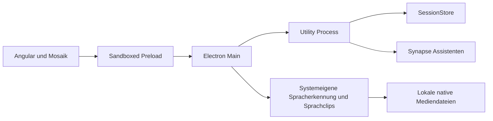

# Desktop, Sitzungen und native Audioanbindung

Stand: 31. Oktober 2026. Diese Seite beschreibt die implementierten Besitzer und
Verträge des ersten Prototyps. Eine vorhandene Implementierung ist getrennt von
Ende-zu-Ende-Nachweisen und von noch offenen Plattformprüfungen zu beurteilen.

## Laufzeit und Verantwortlichkeiten

- Der Angular-Renderer besitzt Ansichten, Mosaik-Steuerelemente, Mikrofonaufnahme,
  Audio-Wiedergabe und den Mediengraphen der Sprachunterhaltung. Er besitzt keine
  Node.js-, Dateisystem-, Shell- oder Schlüsselbundschnittstelle.
- `apps/desktop/src/preload.ts` stellt ausschließlich `window.resonanz.request`
  und `window.resonanz.onEvent` bereit. Anfragen und Antworten werden unabhängig
  mit den Zod-Verträgen aus `@resonanz/contracts` geprüft. Eine Antwort muss die
  Korrelationskennung der Anfrage tragen. Event-Abonnements geben eine
  Abmeldefunktion zurück.
- Electron Main prüft Fenster und Frame des Absenders, vermittelt native Dialoge,
  verwaltet Tray und Fenster und beaufsichtigt genau einen Utility Process.
  Die systemeigene Sprachschnittstelle bleibt im Main; fachliche
  Assistententurns werden im Utility Process koordiniert.
- Der Utility Process besitzt `OrchestratorApplication`, `SessionStore` und den
  langlebigen `AssistantService`. Er persistiert Sitzungen und erstellt die
  fachlichen Analyse-, Frage- und Live-Delegationsaufträge.
- Synapse besitzt CLI-Treiber, isolierte Profile, native Anmeldevorgänge,
  Prozessausführung, Streaming und Abbruch. Die Auswahl von Sessionkontext und
  fachlichen Prompts bleibt in Resonanz. Details stehen in der
  [Assistentenanbindung](../local-assistants/README.md).

Die Prozessgrenzen folgen Symphony. Für den Prototyp werden Sitzungen als
versionierte, atomar ersetzte JSON-Dokumente mit separaten Audiojournalen
persistiert. Symphony verwendet hierfür SQLite; die Wahl von JSON ist eine
bewusste Anpassung des Speicheradapters und kein zusätzlicher Server.

## Start, Tray und Beenden

`tools/build-node-apps.mjs` bündelt Electron Main und den Utility Process als ESM
und den sandboxfähigen Preload als CommonJS. Die Artefakte liegen unter
`dist/apps/desktop` und `dist/apps/orchestrator`; der gepackte Angular-Renderer
wird aus `dist/apps/renderer/browser/index.html` geladen.

Die Anwendung erhält eine Single-Instance-Sperre. Ein zweiter Start öffnet das
bestehende Fenster. Der Tray ist unter macOS und Windows vorgesehen; das
Schließen des Fensters blendet es aus, während die Aufnahme im lebenden Renderer
weiterlaufen kann. Der Tray öffnet Resonanz oder fordert eine neue Aufnahme bzw.
Live-Unterhaltung über ein typisiertes `ui.command`-Event an.

Beim ausdrücklichen Beenden einer aktiven Aufnahme fragt die native Oberfläche
nach. Danach kann der Renderer seine Aufnahme stoppen und letzte Blöcke
bestätigen. Bereits persistierte Blöcke werden auch dann erhalten, wenn der
Renderer nicht rechtzeitig antwortet. Der Main beendet bekannte native Sprachsessions, fordert Synapse- und Schreibbereinigung im Utility Process an und
beendet nur seinen eigenen Hintergrundprozess. Ein abgestürzter Renderer
hinterlässt eine als unterbrochen erkennbare Aufnahme.

Der Hintergrund-Supervisor korreliert maximal 100 wartende Anfragen, begrenzt
normale Anfragen auf 30 Sekunden und Live-Delegationen auf 180 Sekunden. Bei
Prozessabbruch werden wartende Anfragen abgelehnt. Vor einem Ersatzprozess werden registrierte native Kinder bereinigt. Nur bei
bestätigter Bereinigung werden bis zu drei automatische Neustarts versucht;
persistierte Aufnahmen bleiben erhalten. Ein Neustart
stellt unterbrochene Spracherkennung oder Medienwiedergabe nicht stillschweigend
wieder her.

## Native Prozessverantwortung nach einem Absturz

Der Utility-Bootstrap installiert explizit einen Beobachter des eingebauten
Node-Diagnosekanals `child_process.spawn`. Er ersetzt oder verändert den
Synapse-Runner nicht. Nach dem nativen Spawn werden ausschließlich ein
zufälliges Besitz-Token, PID und Detached-Kennzeichen an Main übermittelt;
Kommandozeilen, Prompts und Umgebungswerte gehören nicht zu diesen Nachrichten.
Main erfasst dazu begrenzte Betriebssystem-Metadaten: Elternprozess,
Prozessgruppe und Startzeit. Geschlossene Gruppen bleiben registriert, solange
noch zugehörige Prozesse nachweisbar sind.

Nach unerwartetem Utility-Ende werden bestätigte POSIX-Gruppen zunächst mit
SIGTERM, bei Bedarf mit SIGKILL beendet und ihre Abwesenheit wird abgewartet.
Abweichende Prozessidentität oder nicht belegbare Bereinigung erlaubt weder ein
Signal an einen möglicherweise wiederverwendeten PID noch einen automatischen
Ersatzprozess mit denselben Profilen. Unter Windows wird ein noch vorhandener,
identischer registrierter Stamm mit `taskkill /T` beendet. Ist der Stamm nach
unerwartetem Ende bereits verschwunden, gilt die übrige Baumbereinigung als
unbestätigt und die automatische Wiederaufnahme bleibt gesperrt. Ein bestätigter
normaler Shutdown nutzt zusätzlich Synapses zugesicherte, abgewartete
Runner-Bereinigung.

**Grenze des Prototyps:** Der native Spawn geht seiner nachfolgenden
Diagnosemeldung voraus. Ein harter Absturz vor Meldung und Identitätsbestätigung
kann deshalb nicht als vollständig verwaisungssicher behandelt werden. Die
Implementierung behauptet weder ein Betriebssystem-Job-Objekt noch eine
universelle Vor-Start-Besitzbestätigung. Der stille Prozessfixture hat auf dem vorhandenen POSIX-Host nachgewiesen, dass
ein registrierter, vollständig stiller Stamm samt Nachkomme den hart beendeten
Besitzer zunächst überlebt und anschließend durch den Main-Besitzer beseitigt
wird. Ein unregistrierter Vergleichsprozess bleibt dabei unberührt; die
Testbereinigung bestätigt anschließend auch sein Ende. Es wurden keine
persönlichen KI-Konten verwendet. Die entsprechende Windows-Prüfung bleibt ein
gesonderter Nachweis.

## Sitzungs- und Sammlungsvertrag

`ISessionSummary` beschreibt Identität, Titel, Art, Status, Zeitpunkte, Dauer,
Audioformat und -größe, Favorit, Tags und Sammlung. `ISession` ergänzt Transkript,
Zusammenfassung, Fragen und Antworten, nächste Audiosequenz und die geschützte
Wiedergabe-URL. Absolute Dateipfade und native Provider-Fortsetzungsreferenzen
werden dem Renderer nicht mitgeteilt.

Die Operationsgruppen sind:

| Gruppe                                                       | Verhalten                                                                                      |
| ------------------------------------------------------------ | ---------------------------------------------------------------------------------------------- |
| `bootstrap.get`                                              | Metadaten, Sammlungen, nicht geheime Einstellungen und native Fähigkeiten lesen                |
| `sessions.create/get/update/delete/finish`                   | Aufnahme anlegen, lesen, benennen, organisieren, löschen und abschließen                       |
| `collections.create/update/delete`                           | Sammlungen verwalten; deren Löschen erhält zugehörige Aufnahmen                                |
| `audio.append`                                               | Geordneten, bestätigbaren Audioblock journalisieren                                            |
| `transcript.append/replace`                                  | Sprecherbezogene Fragmente persistieren oder ein Transkript ersetzen                           |
| `sessions.analyze/ask`                                       | Einen echten Synapse-Auftrag aufnehmen und Ergebnisereignisse veröffentlichen                  |
| `assistant.*`                                                | Installation, Status, Anmeldung, Abmeldung und Abbruch des ausgewählten CLI-Assistenten        |
| `speech.start/stop/listen/synthesize/cancel`, `live.respond` | Native Sprache koordinieren und gesprochene Beiträge direkt über Synapse beantworten           |
| `transcription.run`                                          | Fertige Aufzeichnung über die systemeigene Spracherkennung transkribieren                      |
| `sessions.import/export`                                     | Native Dateidialoge öffnen; Export startet in Downloads, Pfade bleiben außerhalb des Renderers |
| `settings.save`                                              | Validierte nicht geheime Konfiguration speichern                                               |

Analysen und Fragen werden mit einer vom Aufrufer erzeugten Run-ID aufgenommen.
Der Aufruf bestätigt die Aufnahme des Auftrags; `assistant.text`,
`assistant.progress`, `assistant.completed` bzw. `assistant.failed` beschreiben
den tatsächlichen Verlauf. Abschließende Ergebnisse und Fragen werden in der
Session gespeichert. Pro Session arbeitet jeweils ein fachlicher Auftrag;
Abbruch beendet den zugehörigen Synapse-Run. Eine Aufnahme darf währenddessen
weiterlaufen. Der Abschluss einer Aufnahme bricht zugehörige Live-Delegationen
ab und wartet deren Bereinigung ab; normale Fragen und Analysen sind davon
unabhängig. Eine späte Antwort darf eine inzwischen pausierte oder beendete
Aufnahme nicht wieder aktivieren. Nur ein Auftrag, der selbst den Zustand
`processing` übernommen hat, darf ihn beim Abschluss atomar zurückgeben.

Vor bewusst gestarteter An-/Abmeldung und vor geänderter Assistentenkonfiguration
werden private native Fortsetzungsreferenzen verworfen. Das gilt auch für später
fehlgeschlagene oder abgebrochene Anmeldevorgänge, da Synapse die Profilgeneration
bereits beim Übergang ändern kann. Transkript, Zusammenfassung und Fragen bleiben
erhalten und liefern einer neuen Session ihren vollständigen Hostkontext. Ein
Host-Bindungszähler verhindert, dass ein älterer, parallel abschließender Run
eine inzwischen ungültige Referenz erneut speichert. Während eines laufenden
Anmelde- oder Konfigurationsübergangs wird keine neue Inferenz aufgenommen. Eine
fehlgeschlagene oder unklare Inferenz wird dafür nicht automatisch wiederholt. Transkriptinhalt wird im Prompt als zitierter Kontext behandelt;
fehlende Aussagen sollen kenntlich bleiben und Zeitmarken konkrete Antworten
belegen.

## Audiojournal und Wiederherstellung

Jede Aufnahme hat ein privates Verzeichnis. Audioblöcke sind **ab 1** lückenlos
nummeriert und auf 4 MiB pro Nachricht begrenzt. Identische Wiederholungen bereits
bestätigter Blöcke sind idempotent; abweichende Wiederholungen und Sequenzlücken
werden abgelehnt. Metadatenänderungen werden erst nach erfolgreichem atomarem
Dateiersatz in den sichtbaren Speicherzustand übernommen.

Beim Abschluss entsteht aus den geordneten Blöcken eine zusammenhängende
Audiodatei mit passender Dateiendung. Fehlerhaft beendete Aufnahmen können ihre
bereits gespeicherte Teildatei behalten und tragen den Status `error` mit einer
Erklärung. Nach einem Prozessabbruch werden vorhandene vollständige Journalblöcke
wieder eingelesen; aktive Zustände werden als `interrupted` gekennzeichnet und
vorhandenes Audio wird wieder abspielbar gemacht. Es wird kein vollständiges
Gespräch vorgetäuscht, wenn die Quelle abgerissen ist.

Eine Session ist auf 512 MiB Audio begrenzt. Transkripte enthalten höchstens
20.000 Fragmente und insgesamt zwei Millionen Textzeichen. Der Katalog akzeptiert
höchstens 5.000 Sessions und 200 Sammlungen. Das sind technische Grenzen des
Prototyps; Lasttests für diese Maximalgrößen stehen noch aus.

Die Wiedergabe verwendet `resonanz-audio://session/<UUID>`. Der Handler akzeptiert
nur vorhandene Sessionkennungen, keine Dateipfade. Er unterstützt begrenzte
Byte-Range-Anfragen für das Springen in Aufnahmen. Eine exportierte JSON-Datei
enthält Sessionmetadaten, Transkript und Fragen; Audio wird über den eigenen
Audioexport gespeichert. Beim erneuten JSON-Import entsteht eine neue Session
und eine fehlende Audiodatei wird nicht als vorhanden markiert.

## Keylose Sprachunterhaltung und Transkription

Der native Host besitzt Spracherkennung und die Erzeugung lokaler WAV-Sprachclips.
Auf macOS wird die vorhandene `electron-native-speech`-Integration verwendet;
Windows verwendet die installierten System.Speech-/SAPI-Sprachkomponenten. Stimme,
Sprache und Verfügbarkeit werden vom Betriebssystem erfragt. Es gibt keinen
zusätzlichen Audioprovider und keine API-Key-Ablage im Produkt.

`speech.start` beginnt die Erkennung für eine vorhandene Session. `speech.listen`
koordiniert Mute und Sprechphasen. Teilresultate werden einer stabilen
Segmentkennung zugeordnet; bestätigte Beiträge werden vor dem finalen Ereignis
persistiert. `live.respond` führt darauf einen wirklichen Synapse-Turn mit dem
aktuellen Gesprächskontext aus. Textdeltas und Abschluss bleiben an Session und
Run-ID gebunden. Ein abgebrochener Turn darf keine späte Ausgabe einschleusen.

`speech.synthesize` erzeugt einen begrenzten lokalen WAV-Clip für einen
Antwortabschnitt. Der Renderer erhält eine geschützte `resonanz-voice`-URL,
keinen beliebigen Dateipfad. Die tatsächlich abgespielten Clips bilden den
Assistentenkanal der Stereoaufnahme. Sprachsynthese und Wiedererkennung werden
so koordiniert, dass die App ihre eigene Ausgabe nicht als neuen Nutzerturn
behandelt. Stop und Pause warten native Ressourcenfreigabe ab.

Dateitranskription verwendet auf macOS den nativen Dateipfad. Für Windows werden
unterstützte Browser-Audioformate lokal decodiert, in mono16kHz/PCM16-WAV
umgewandelt und begrenzt an den Host übergeben. Die temporäre WAV-Datei liegt im
privaten App-Verzeichnis und wird auch bei Fehlern entfernt. Dieser Pfad ist auf
64MiB PCM-WAV begrenzt; das ursprüngliche Aufnahmeformat und Archiv bleiben
unverändert. Fehlende native Sprachpakete werden nicht durch Cloudaufrufe ersetzt.

## Anmeldung und Verpackung

Die KI-Anmeldung gehört zu Synapse und der ausgewählten nativen CLI. Browser- und
Geräteanmeldung werden als korrelierte Kontovorgänge angeboten. Derselbe Account
trägt Analyse, Fragen und Sprachturns. Die Produktoberfläche hat keine
API-Key-Einrichtung.

Forge verwendet eigene Resonanz-Icons, einen eigenen Bundle-Identifier und auf
macOS beide Nutzungsbeschreibungen für Mikrofon und Spracherkennung. Der native
SpeechHelper wird außerhalb des ASAR-Archivs als Ressource mitgeliefert. Die
Drittlizenzen werden als `THIRD_PARTY_NOTICES.md` ebenfalls in die App übernommen.
Die gebündelten Anwendungen enthalten Synapse und die privaten Workspaces. Forge
übernimmt ausschließlich die drei spät geladenen nativen Speech-Pakete aus
`node_modules` und schreibt nur im Paket-Staging ein reduziertes Laufzeitmanifest;
das Quellmanifest mit Workspace- und Vendor-Abhängigkeiten bleibt erhalten.
Das lokale Paket entsteht unter `out/Resonanz-<Plattform>-<Architektur>`.
`node tools/verify-package.mjs` prüft dort die tatsächlichen ASAR-Bundles und
Rendererdateien gegen den aktuellen Build, die native Abhängigkeitsmenge,
externe Icons und Lizenzhinweise sowie auf macOS Nutzungsbeschreibungen,
ausführbaren SpeechHelper und lokale Codesign-Konsistenz. Sein Prüfbericht liegt
im ignorierten `.codex-work/out/`; die Existenz dieses Skripts allein ist kein
Nachweis einer erfolgreichen Paketprüfung.
Lokale macOS-Pakete werden ad hoc signiert. Eine notarisiert veröffentlichte App
oder eine verifizierte Windows-Installation ist damit noch nicht nachgewiesen.

## Referenzen und Prüfung

Die übernommenen Symphony-Muster wurden am lokalen Referenzstand
`4eac851f2dc465c4ed1ae7a09c245d6bce5de4ee` geprüft, besonders Preload, Main,
Utility-Transport, esbuild-/Forge-Konfiguration und Icon-Ressourcen. Die Audioübernahme und die systemeigenen Sprachschnittstellen sind getrennte
Integrationsgrenzen. Aktuelle Typ-, Verhaltens-, App- und Paketnachweise stehen
in der [Abnahme](../../project/abnahme.md). Ein erfolgreicher Systemstart ersetzt
keine echte Mikrofon-/Spracherkennungsprüfung auf einer weiteren Zielplattform.
